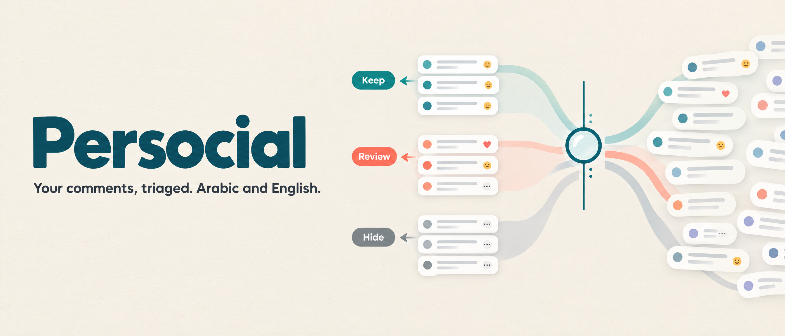
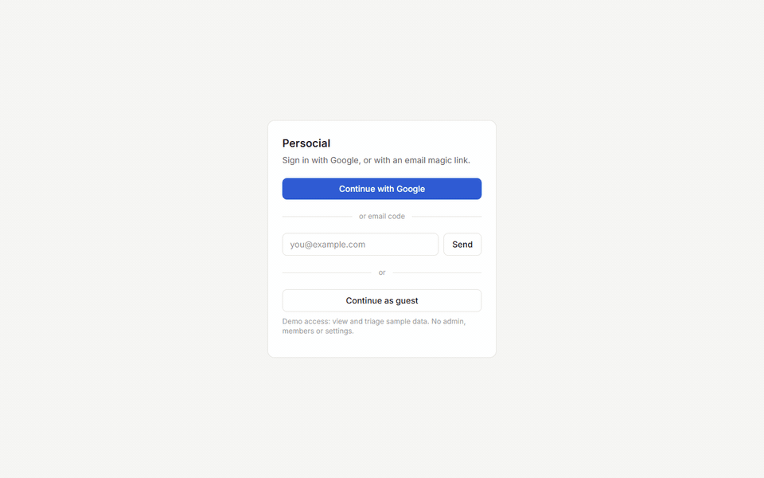
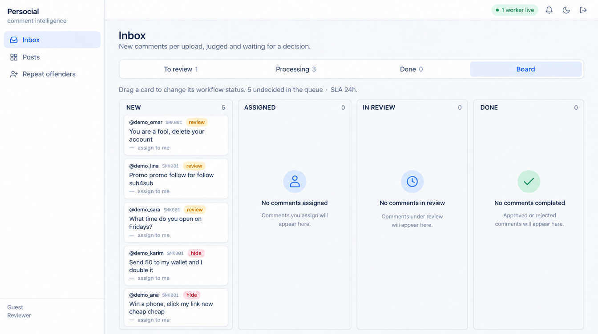
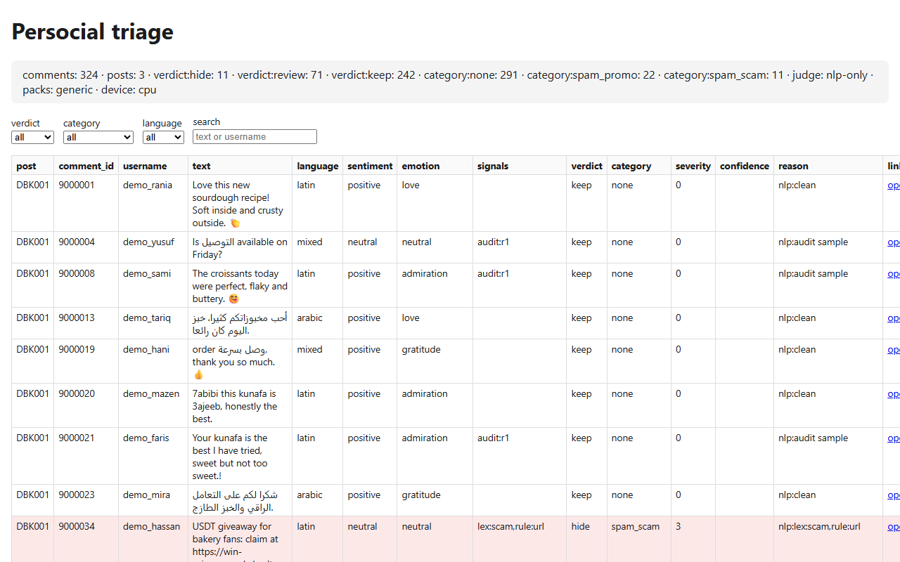
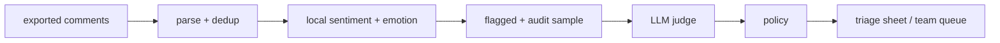

# Persocial

**Open-source comment triage for your own Instagram. Arabic and English, scored locally.**

[](https://github.com/haitham72/Persocial/actions/workflows/ci.yml)
[](LICENSE)
[](pyproject.toml)
[](supabase/)



## Why

Nobody reads 5,000 comments. Persocial scores every comment on your machine,
sends only the risky few to an LLM judge, and hands you either a triage sheet
(solo) or a shared reviewer queue (team). Gulf, Egyptian and MSA Arabic plus
Arabizi are first-class, not an afterthought.

## Features

- Local sentiment and emotion scoring (Hugging Face models, CPU or GPU). No comment text leaves the machine for scoring.
- LLM judge over flagged comments plus an adaptive audit sample, via any OpenAI-compatible endpoint (LM Studio, Ollama, hosted). Every judge call is stored.
- Arabic region packs (`generic`, `gulf_ar`): dialect cues, Arabizi spellings, scam and wallet signals.
- Solo mode: one command produces `triage.xlsx`, `triage.csv` and a self-contained `triage.html`.
- Team mode: React app on Supabase with inbox, four-column board, assignee and SLA badges, and an audit timeline of every decision.
- Incremental re-runs: already stored comments add zero rows.

| Board (team, enhanced render of the actual UI) | Triage report (solo, unedited capture) |
|---|---|
|  |  |

## Quickstart: solo (CLI, no database)

Python 3.11+, about 1 GB of disk for the models.

```powershell
python -m venv .venv
.venv\Scripts\pip install -e ".[scoring]"
.venv\Scripts\persocial models pull
.venv\Scripts\persocial run examples/sample/apify.json --out triage --no-judge
start triage.html
```

macOS/Linux: use `.venv/bin/` instead of `.venv\Scripts\`. Judge setup and
`persocial doctor`: [docs/quickstart-solo.md](docs/quickstart-solo.md).

## Quickstart: team (Supabase + web)

Needs Docker, the Supabase CLI and Node 22.

```powershell
pip install -e ".[team,scoring]"
supabase start
persocial bootstrap --demo          # judge defaults + synthetic sample data
persocial worker --score            # scores queued comments
# in another shell
cd web
copy .env.example .env.local        # fill VITE_SUPABASE_ANON_KEY from `supabase status -o env`
npm ci
npm run dev                         # http://127.0.0.1:5180
```

Details, ports and the 21-check smoke test: [docs/quickstart-team.md](docs/quickstart-team.md).

> **Guest mode is for the local demo only.** `VITE_GUEST_LOGIN=true` (web) plus
> `enable_anonymous_sign_ins = true` (`supabase/config.toml`) add a
> "Continue as guest" button that signs anyone in as a restricted reviewer
> (no admin, no settings, no members). Turn both off for any real deployment.

## Architecture



Score everything locally, judge only what matters, audit the judge, a human
decides. Postgres is the hub in team mode; SQLite is the store in solo mode.
Details: [docs/architecture.md](docs/architecture.md).

## Arabic support and eval gate

`evals/run_eval.py` runs an 80-case hand-written golden set (synthetic Gulf,
Egyptian, MSA, Arabizi and English comments) against the real normalization,
script detection and signal code. CI gates each part at 95%. Current result:
normalize 80/80, script 80/80, signals 80/80. The judge category check uses a
deterministic stub, so it is reported, not gated. The set is small and
synthetic: it guards regressions, it is not a benchmark.

```powershell
.venv\Scripts\python evals\run_eval.py
```

## Configuration

Copy `.env.example` to `.env`. Common settings:

| Variable | Purpose |
|---|---|
| `PERSOCIAL_JUDGE_BASE_URL` / `PERSOCIAL_JUDGE_MODEL` | OpenAI-compatible judge endpoint and model |
| `PERSOCIAL_PACKS` | `generic` or `generic,gulf_ar` |
| `PERSOCIAL_TZ` | IANA zone for naive timestamps and display |
| `SCORING_DEVICE` | `auto`, `cuda`, `mps` or `cpu` |
| `VITE_GUEST_LOGIN` | demo-only guest button (web) |

Input formats: [docs/input-format.md](docs/input-format.md). Taxonomy: [docs/taxonomy.md](docs/taxonomy.md).

## Development

```powershell
pip install -e ".[dev,team,scoring]"
.venv\Scripts\python -m pytest -q            # DB tests need `supabase start`; add -m "not db" to skip them
.venv\Scripts\ruff check persocial tests scripts evals examples
cd web; npm ci; npm run build
```

CI runs lint, pure tests, DB tests on local Supabase, the web build and smoke
test, and a gitleaks scan. Contributing: [CONTRIBUTING.md](CONTRIBUTING.md).
Security and what leaves your machine: [SECURITY.md](SECURITY.md). Comparison
with commercial suites: [docs/comparison.md](docs/comparison.md). Roadmap:
[docs/roadmap.md](docs/roadmap.md). Changes: [CHANGELOG.md](CHANGELOG.md).

## License

MIT, see [LICENSE](LICENSE).
