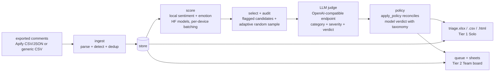

# Architecture

How a comment travels from your export to a decision. Same pipeline in both
tiers; only the store and the surface differ.

## Principles

- **Score everything locally.** Sentiment + emotion run on your machine
  (`persocial/scoring/core.py`, also embedded verbatim in
  `colab/score_csv.ipynb`); no comment text leaves the machine for scoring.
- **Judge only what matters.** The judge sees flagged candidates plus an
  adaptive audit sample (`persocial/judge/select.py`), not the whole firehose.
- **Audit the judge.** Every judge call is stored (`judge_calls` in Team,
  audit sheet in Solo) and doubles as a fine-tuning set (`persocial dataset`).
- **A human decides.** Solo: you read the triage sheet. Team: reviewers hide /
  keep / escalate on the board; every decision, assignee, status and IG-action
  change lands in `comment_events` with actor and timestamp.

## Tier 1 Solo (headless)

`persocial run INPUT [--out triage] [--format xlsx,csv,html] [--packs ...]
[--no-judge] [--device ...]` — one process, no network except the judge:

| Step | Module | Store |
|---|---|---|
| parse | `persocial/ingest/parsers.py` | — |
| dedup + state | `persocial/local/store.py` | SQLite `./.persocial/persocial.db` (upsert by `ig_id`; re-runs add +0) |
| score | `persocial/scoring/core.py` (`Scorer`, unchanged) | score columns in SQLite |
| select + audit | `persocial/judge/select.py` (unchanged) | candidate flags in SQLite |
| judge | `persocial/judge/client.py` + `runner` pieces (`judge_batch`, unchanged) | judgments in SQLite |
| verdicts | `persocial/judge/taxonomy.py` (`apply_policy`, unchanged) | final verdict per comment |
| reports | `persocial/local/report.py` | `triage.xlsx` (To review / Hidden-suggested / Keep / Audit / Summary), `triage.csv`, self-contained `triage.html` |

`--no-judge` skips the judge and triages from NLP signals alone (hide on
scam/wallet signals, else review/keep via `apply_policy`). Tier 1 reuses the
Team-tested modules unchanged and adapts at the store boundary — see
`persocial/local/` docstrings.

## Tier 2 Team (Supabase + React)

Postgres is the hub; the web app, the worker and Colab all talk to it:

- **Ingest:** Upload page → server parser (`parse.ts`, parity-tested against
  `parsers.py` via `shared/input-aliases.json`) → `ingest_*` RPCs → `comments`,
  `posts`, `uploads`, `review_sheets`.
- **Score:** Colab GPU (`colab/score_csv.ipynb`, generated from `core.py`) or
  `persocial worker --score`; leases in `posts` (`claimed_by/at`) keep one
  scorer per post.
- **Judge:** `persocial worker` / Judge Lab runs `judge_batch` over candidates;
  verdicts land on `comments` with model, prompt version and reason.
- **Review:** `queue_comments` feeds Inbox/Board; RLS keeps reviewers to their
  lane (reviewers cannot touch `verdict`); the audit trigger stamps every
  decision/assignee/status/IG-action change with the member email.
- **Act:** autohide (shadow/live, `auto_actions`), saved replies, notifications.

Schema: three squashed migrations (`0001_schema.sql` tables/indexes,
`0002_logic.sql` RPCs/workers/grants, `0003_team.sql` board/audit/SLA).

## Configuration

Everything comes from env (see `.env.example`): `PERSOCIAL_TZ` (default UTC),
`PERSOCIAL_JUDGE_BASE_URL` (default `http://127.0.0.1:1234/v1`),
`PERSOCIAL_JUDGE_MODEL` (empty = DB default), `PERSOCIAL_PACKS`
(`generic[,gulf_ar]`), `SCORING_DEVICE` (`auto|cuda|mps|cpu`; Solo CLI
defaults to `cpu`), Supabase URLs/keys. No hardcoded hosts besides localhost
defaults.
